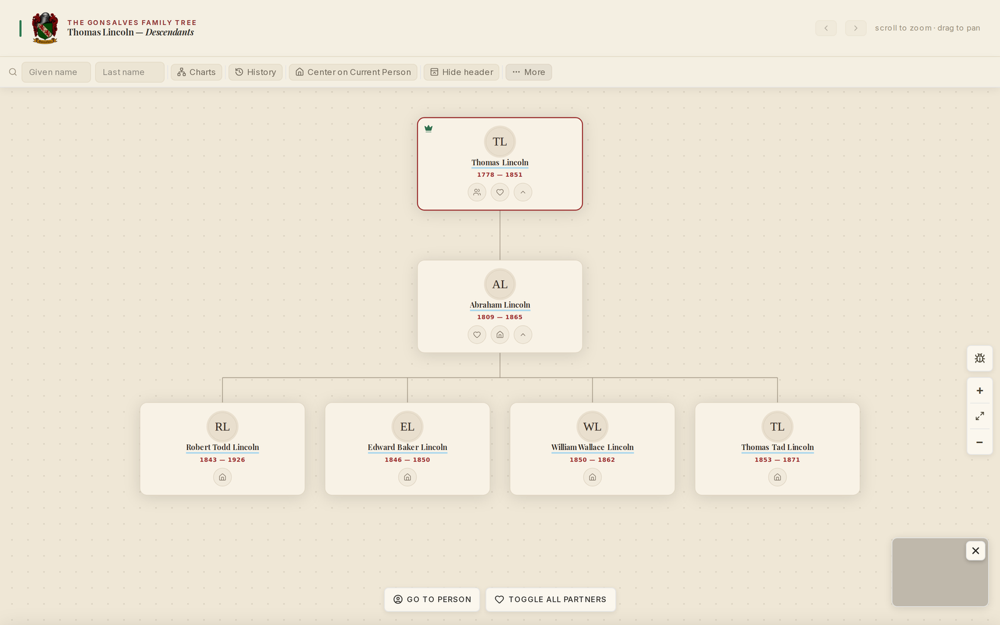
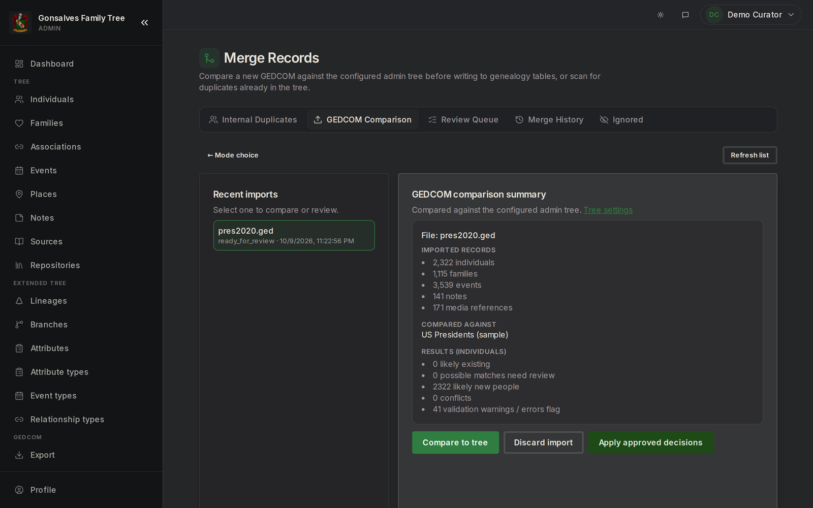
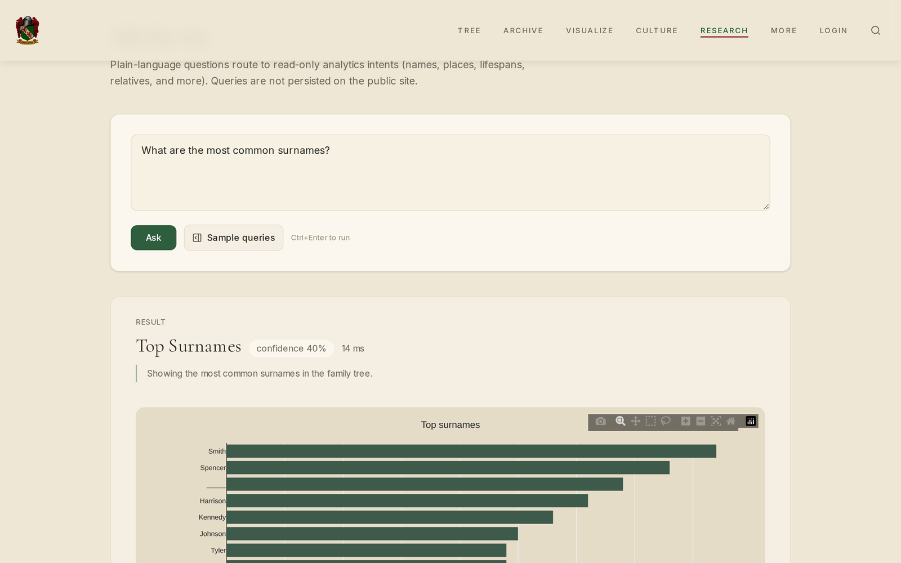
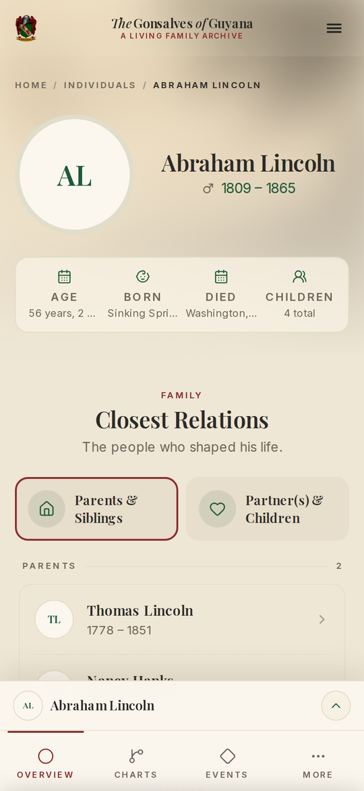

# Ligneous

Ligneous is a genealogy platform. It parses GEDCOM family-tree files in Go, stores them in Postgres, and serves them as family-history websites that people can browse, search and add stories to. It runs [gonsalvesfamily.com](https://gonsalvesfamily.com), a live family-history site with its own admin app.

This repository is the map of the project. The code is in the repositories below.

## How the pieces fit

```
 .ged file uploaded in the admin app
    |
    v
 ligneous-gedcom-lib-api (Go, HTTP)        POST /api/v1/parse-validate-enrich
    |  uses ligneous-gedcom-lib:            parse -> validate -> enrich
    |
    v
 EnrichedDocument (JSON)                   the intermediate representation:
    |                                       flat, deduplicated tables
    v
 admin app: review, merge plan, apply  --> Postgres (gedcom_* tables, Prisma)
                                              |
              +-------------------------------+------------------------+
              |                                                        |
              v                                                        v
 public site (Next.js): people, trees,          ligneous-gedcom-flask-api (Python):
 albums, stories, timelines                     statistics, lineages, relationship
 drawn with @ligneous/* packages                paths, natural-language search
```

The Go library turns a GEDCOM file into an **intermediate representation**: an `EnrichedDocument` of flat tables (people, families, parsed dates, split places, events, parent/child edges) that maps one-to-one onto the Postgres tables. The front ends never parse GEDCOM themselves. They import that JSON, and export goes back through the same API. The [library README](https://github.com/lesfleursdelanuitdev/ligneous-gedcom-lib#the-intermediate-representation-ir) has the details and real examples.

**Why Go for the parser:** Go suits a line-based, typed parser that compiles to one static binary. Its HTTP server handles each request on its own goroutine, and the library is safe to use from many goroutines at once, so several uploads are parsed in parallel. A 1.1 MB GEDCOM file parses in about 38 ms.

## Screenshots

The family site and its admin app, running on a demo database loaded with the public US-presidents sample tree (`pres2020.ged`) through the real import pipeline. No family data is shown.

| | |
|---|---|
|  |  |
| **Charts**: laid out by the visualization engine | **Fan chart**: five generations |
|  |  |
| **Story editor**: text linked to people in the tree | **GEDCOM import**: parsed, validated and enriched by the Go library before anything is written |
|  |  |
| **Plain-language search**: questions mapped to allowlisted SQL | **On a phone** |

## Repositories

### Core

| Repository | Language | What it does |
|---|---|---|
| [ligneous-gedcom-lib](https://github.com/lesfleursdelanuitdev/ligneous-gedcom-lib) | Go | GEDCOM parser, validator (37 finding codes), enricher, exporter and merge planning, with command-line tools. 102 tests. |
| [ligneous-gedcom-lib-api](https://github.com/lesfleursdelanuitdev/ligneous-gedcom-lib-api) | Go | HTTP API over the library: parse, validate, enrich, export and reconcile |
| [ligneous-gedcom-flask-api](https://github.com/lesfleursdelanuitdev/ligneous-gedcom-flask-api) | Python | Research API (Flask): statistics, lineage detection, relationship paths, and natural-language search that maps questions to allowlisted SQL through an LLM |

### Front-end packages

| Repository | Language | What it does |
|---|---|---|
| [genealogy-visualization-engine](https://github.com/lesfleursdelanuitdev/genealogy-visualization-engine) | TypeScript | Headless layout engine for descendancy, pedigree and fan charts; the app draws the result as SVG |
| [ligneous-story-creator](https://github.com/lesfleursdelanuitdev/ligneous-story-creator) | TypeScript | Block-based story editor (TipTap, Zustand) whose links point at people and events in the tree |
| [ligneous-album-view](https://github.com/lesfleursdelanuitdev/ligneous-album-view) | TypeScript | Types and helpers for photo albums generated from the tree |
| [ligneous-album-generated-queries](https://github.com/lesfleursdelanuitdev/ligneous-album-generated-queries) | TypeScript | Prisma queries that build those albums from people, families, events, places and tags |

### Applications (private source)

The public site and the admin app are Next.js apps. Their source is private because it contains family data, and several shared packages (the Prisma schema, auth, date and event helpers) are private too. The public site is live at [gonsalvesfamily.com](https://gonsalvesfamily.com). Source is available on request.

## Stack

Go, Python (Flask), TypeScript, React, Next.js, Prisma, Postgres, TipTap and Tailwind. In production everything runs as rootless Podman containers under systemd, behind nginx.

## Status

gonsalvesfamily.com is live and these libraries run in production behind it. They are still evolving.
