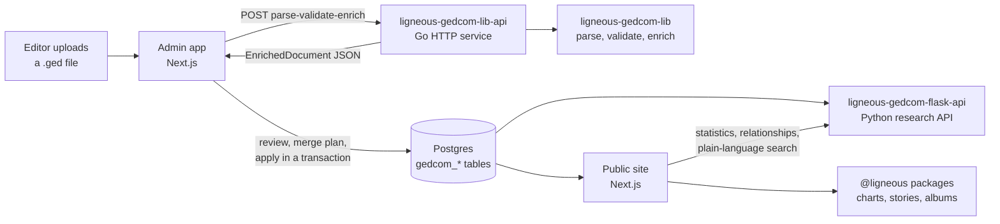

# Ligneous

Ligneous is a genealogy platform. It parses GEDCOM family-tree files in Go, stores them in Postgres, and serves them as a family-history website where people browse relatives, explore charts, read and write family stories, and ask questions in plain language. It runs **[gonsalvesfamily.com](https://gonsalvesfamily.com)**, a live family-history site with a separate admin app for the family's editors.

Built by [lesfleursdelanuitdev](https://github.com/lesfleursdelanuitdev). This repository connects the pieces; the code lives in the repositories listed at the end.

## Screenshots

These come from the family site and its admin app running on a demo database. The public US-presidents sample tree (`pres2020.ged`) was loaded through the real import pipeline, so no family data is shown.

| | |
|---|---|
|  |  |
| **Charts**: laid out by the visualization engine | **Fan chart**: five generations |
|  |  |
| **Story editor**: text linked to people in the tree | **GEDCOM import**: parsed, validated and enriched by the Go library before anything is written |
|  |  |
| **Plain-language search**: questions mapped to allowlisted SQL | **On a phone** |

More screenshots are in each repository's README.

## Architecture

1. **Import.** An editor uploads a GEDCOM file in the admin app. The Go service parses it, validates it and turns it into an **intermediate representation**: an `EnrichedDocument` of flat, deduplicated tables (people, families, parsed dates, split places, events, parent/child edges) that lines up with the Postgres tables. The front ends never parse GEDCOM themselves.
2. **Review.** Before anything is written, the admin app shows the validator's findings and asks the Go service for a merge plan against the existing tree: who is already there, who is new, and what conflicts.
3. **Apply.** Approved changes go into Postgres through Prisma in one transaction.
4. **Read.** The public site reads Postgres directly for people, charts, timelines, albums and stories. For statistics, lineages, relationship paths and plain-language questions, it calls the Python research API.
5. **Export.** The admin app sends the tree back through the Go service to produce GEDCOM, JSON or CSV.

In production every service runs as a rootless Podman container under systemd, behind nginx. The Go and Python services listen only on the server itself.

## Engineering highlights

- **A GEDCOM parser in Go with a typed intermediate representation.** It does line-based parsing with errors that carry line numbers, and keeps a lossless tree that can be written back out unchanged. The enriched form deduplicates dates and places and parses fuzzy dates (`ABT 1950`, `BET 1840 AND 1845`) into type and calendar. A 1.1 MB file parses in about 38 ms. [Why Go, and the IR in detail](https://github.com/lesfleursdelanuitdev/ligneous-gedcom-lib#why-go)
- **Validation with stable codes.** 37 finding codes, such as `ORPHANED_FAMC`, `DEATH_BEFORE_BIRTH` and `MOTHER_TOO_YOUNG_AT_CHILD_BIRTH`, at three severities. Editors see them before an import is applied.
- **Record reconciliation.** Comparing a new file against the live tree produces a merge plan without writing anything. It aligns people by id and xref, then optionally runs fuzzy matching with an optimal (min-cost) assignment inside blocking buckets, and reports diffs and conflicts for an editor to approve.
- **Plain-language questions without free-form SQL.** The research API maps a question to one of 34 intents, using an LLM (Groq) with a keyword fallback. Each intent runs a fixed, allowlisted SQL query, so the model never writes SQL.
- **A headless chart engine.** Descendancy, pedigree, vertical pedigree and fan-chart layouts are pure functions that return positions and SVG paths. The React app draws them. The descendancy layout is two-pass (widths bottom-up, positions top-down), and the fan chart uses polar geometry.
- **Family stories linked to the tree.** A block-based editor built on TipTap, whose links point at people and events by id, so a story links straight to the people it mentions.

## Testing

| Part | Tests | Result |
|---|---|---|
| Go library | 102 tests (`go test ./...`), plus benchmarks | all pass |
| Go API | 3 tests | all pass |
| Python research API | 135 tests (pytest) | 119 pass, 10 skipped (need a database), 6 fail: 5 relationship-label tests that expose a real bug (sex read from the wrong person) and 1 that needs a database |
| Story editor package | 127 Vitest cases in 9 files | not run in this check |

Each repository's `docs/ARCHITECTURE.md` lists its limitations and known bugs openly.

## Repositories

### Core

| Repository | Language | What it does |
|---|---|---|
| [ligneous-gedcom-lib](https://github.com/lesfleursdelanuitdev/ligneous-gedcom-lib) | Go | GEDCOM parser, validator, enricher, exporter and merge planning, with command-line tools |
| [ligneous-gedcom-lib-api](https://github.com/lesfleursdelanuitdev/ligneous-gedcom-lib-api) | Go | HTTP API over the library: parse, validate, enrich, export and reconcile |
| [ligneous-gedcom-flask-api](https://github.com/lesfleursdelanuitdev/ligneous-gedcom-flask-api) | Python | Research API (Flask): statistics, lineage detection, relationship paths and plain-language search |

### Front-end packages

| Repository | Language | What it does |
|---|---|---|
| [genealogy-visualization-engine](https://github.com/lesfleursdelanuitdev/genealogy-visualization-engine) | TypeScript | Headless layout engine for descendancy, pedigree and fan charts |
| [ligneous-story-creator](https://github.com/lesfleursdelanuitdev/ligneous-story-creator) | TypeScript | Block-based story editor (TipTap, Zustand) whose links point at people and events in the tree |
| [ligneous-album-view](https://github.com/lesfleursdelanuitdev/ligneous-album-view) | TypeScript | Types and helpers for photo albums generated from the tree |
| [ligneous-album-generated-queries](https://github.com/lesfleursdelanuitdev/ligneous-album-generated-queries) | TypeScript | Prisma queries that build those albums from people, families, events, places and tags |

### Applications (private source)

The public site and the admin app are Next.js apps. Their source is private because it contains family data, and several shared packages are private too: the Prisma schema, auth, and the date and event helpers. The public site is live at [gonsalvesfamily.com](https://gonsalvesfamily.com). Source is available on request.

## Stack

Go, Python (Flask), TypeScript, React, Next.js, Prisma, Postgres, TipTap, Tailwind, Podman, systemd and nginx.
